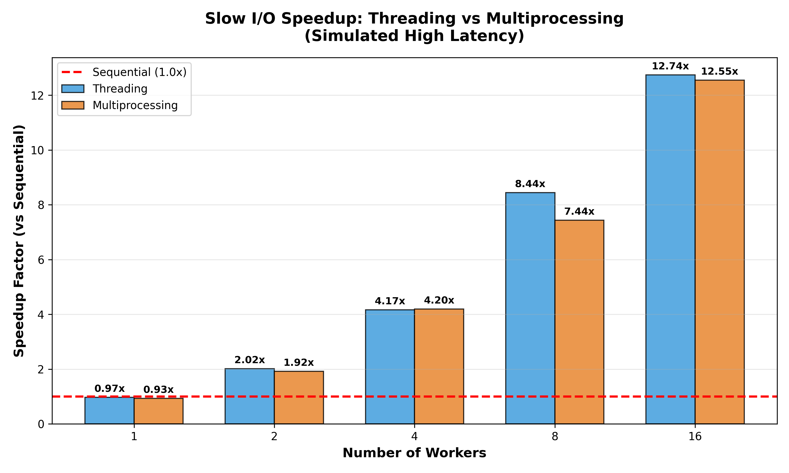
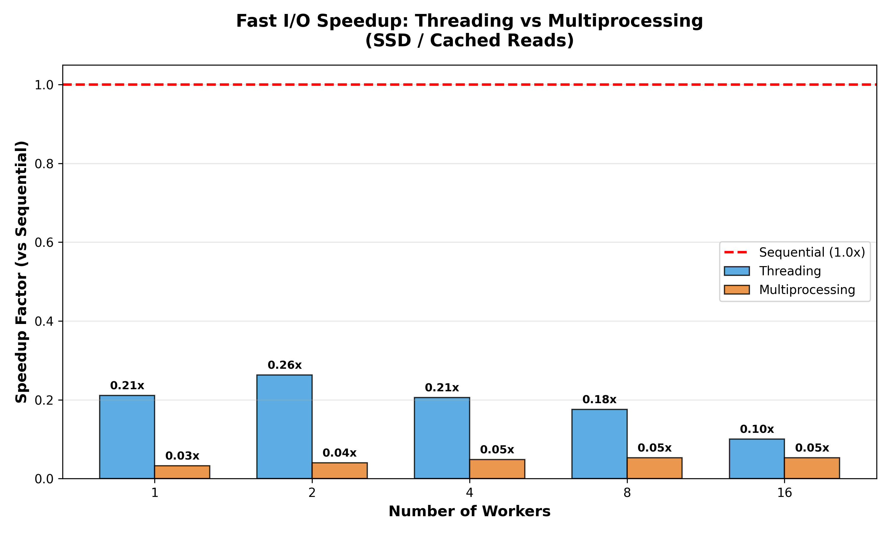
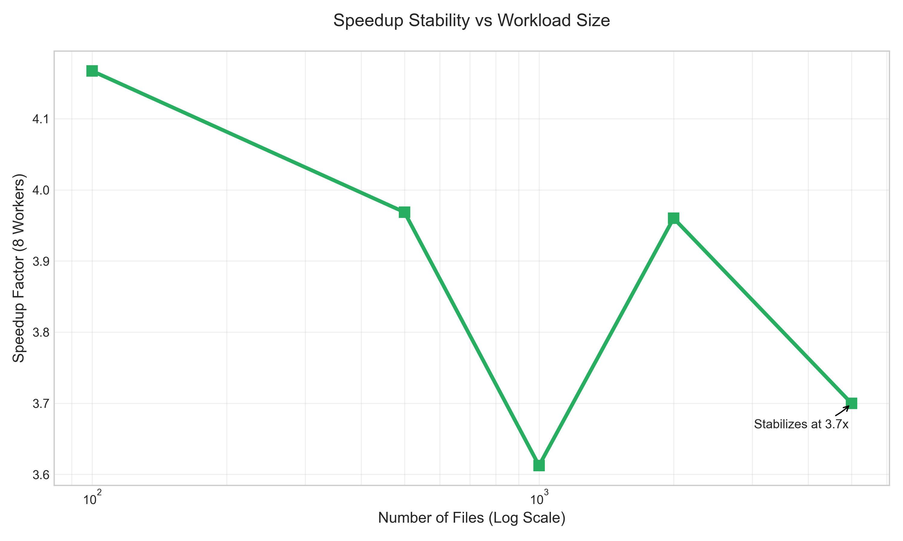
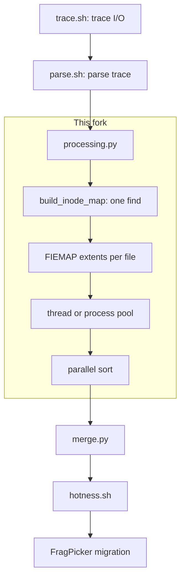

<div align="center">

# FragPicker, parallel analysis

**A fork of FragPicker whose file-analysis phase can run on many workers, and a measurement of when that helps**

[](LICENSE)
[](#installation)
[](https://github.com/jonggyup/FragPicker)
[](https://doi.org/10.1145/3477132.3483593)

[What this fork adds](#what-this-fork-adds) · [Results](#results) · [How it works](#how-it-works) · [Installation](#installation) · [Quick start](#quick-start) · [Reproducing the benchmarks](#reproducing-the-benchmarks) · [Credits](#origin-and-credits)

</div>

FragPicker is a defragmentation tool for modern storage devices, published at SOSP 2021. It traces what an application reads and writes, finds the file regions that matter, and migrates only those. Its analysis phase looks at files one at a time.

This fork, on the branch `parallel-analysis`, changes that phase. It builds one inode-to-path map instead of running `find` per file, reads file extents with the FIEMAP ioctl instead of spawning `filefrag`, and can process files on a pool of threads or processes. The migration phase is still the upstream code.

Headline result, with its condition: with 5 ms of artificial delay added to every file, 1,000 files of 100 KB, and 16 threads, analysis took 0.57 s against 7.28 s for the sequential path (12.74x). Without the delay, on an NVMe SSD, the sequential path was the fastest option and every parallel setting was slower. The delay is a simulation, so read the number as a trend, not as a prediction for a given disk. See [Results](#results).

Upstream pull request [jonggyup/FragPicker#2](https://github.com/jonggyup/FragPicker/pull/2) is open, not merged. The maintainer asked to keep this work on a separate branch, which is why it lives here.

## What this fork adds

| Area | Upstream FragPicker | This branch |
|---|---|---|
| Inode to path | one `find` per file | one `find` for the whole mount point, then a dictionary lookup |
| Extent detection | `filefrag` subprocess per file | FIEMAP ioctl through `ctypes` |
| File processing | sequential | sequential (default) or `--parallel` with threads or processes |
| Analysis-phase benchmarks | not included | tests, benchmark scripts, raw results and charts in this repository |

New and changed files:

- `src/analysis/parallel_analyzer/` (new): the FIEMAP wrapper, the inode mapper, the thread and process engines, the parallel sorter, configuration, logging, profiling and progress monitoring.
- `src/analysis/processing.py` (changed): a `--parallel` mode. Run without arguments it behaves as before.
- `tests/`, `benchmarks/`, `benchmark_results/`, `tools/`, `config/` (new).

A study of the results is included as a PDF: [Parallelizing File Fragmentation Analysis: A Performance Study of FragPicker](Parallelizing%20File%20Fragmentation%20Analysis%20A%20Performance%20Study%20of%20FragPicker.pdf).

## Results

Setup for the first two charts: 1,000 files of 100 KB each, medians of 3 runs, sequential time as the baseline, a 4-core Intel CPU with an NVMe SSD on ext4. Raw numbers: [`benchmark_results/simple_io_benchmark_20251205_180129.json`](benchmark_results/simple_io_benchmark_20251205_180129.json).

**When delay dominates (5 ms added per file).** Sequential: 7.28 s. Threads reach 12.74x at 16 workers (0.57 s), processes 12.55x (0.58 s). One worker is slightly slower than sequential (0.97x threads, 0.93x processes).



**When there is no delay (native NVMe).** Sequential: 0.028 s for 1,000 files. Threads reach 0.10x to 0.26x of that speed, processes 0.03x to 0.05x. The work per file is so small that starting workers and collecting results costs more than the work.



**A smaller delay gives a smaller gain.** A separate run (script: [`benchmarks/scalability_slow_io_test.py`](benchmarks/scalability_slow_io_test.py)) adds 1 ms per file and uses 10 KB files. With 8 workers the speedup stays between 3.6x and 4.2x for 100 to 5,000 files. In the same script's 1,000-file scaling run it peaks at 3.66x with 8 workers and is 3.41x with 16.



What to take from the three charts:

- Parallelism helps when each file spends time waiting. The simulation stands in for slow disks and network storage; no real HDD or network file system was measured here.
- It does not help, and costs time, when each file takes microseconds. Keep the default sequential mode on fast local storage.
- Time per file is almost all of the run: in an overhead profile of 1,000 files, file processing was 99.89% of sequential time and inode mapping 0.11% ([`overhead_profiling_results.json`](benchmark_results/overhead_profiling_results.json); the file does not record the delay used in that run).

Other charts and data are in [`benchmark_results/`](benchmark_results/): efficiency and Amdahl curves (`fast_io_*.png`, `slow_io_*.png`), `overhead_breakdown.png`, `memory_analysis.png`, and the JSON files behind them.

### Limits of these results

- One machine, one filesystem, synthetic files of random data. No measurement on real fragmented file systems.
- The delay is added in software before each extent lookup. It does not model seek order, caching or command queuing.
- The 5 ms results come from [`simple_io_benchmark_20251205_180129.json`](benchmark_results/simple_io_benchmark_20251205_180129.json) and its `config` block. The benchmark scripts in this repository use 1 ms (and `tests/test_slow_io_proof.py` uses 2 ms); no script here writes that 5 ms file. The 5 ms run is therefore documented by its results file and the study PDF, not by a runnable script.
- Correctness is checked by tests that compare sequential and parallel output, for example on 100 and 1,000 files in [`tests/test_correctness_validation.py`](tests/test_correctness_validation.py).

## How it works

The analysis phase reads a trace of the application's I/O, finds the files it touched, and records each file's extents. This fork changes the steps in the "This fork" box.



Per-file extent lookups do not depend on each other, so they can run side by side. The inode map is built once, before the workers start, and only read afterwards.

A module overview and a longer listing of the repository are in [docs/LAYOUT.md](docs/LAYOUT.md).

## Installation

Requirements: Linux, Python 3, and the `find` command. The FIEMAP interface needs Linux 2.6.28 or later and a filesystem that supports it. The Python packages are listed in [`requirements.txt`](requirements.txt): PyYAML and psutil are needed by the analyzer, the rest are optional.

```bash
git clone -b parallel-analysis https://github.com/YuzhengShi/FragPicker.git
cd FragPicker

pip install -r requirements.txt            # pyyaml, psutil
pip install matplotlib numpy flask pytest  # optional: charts, web dashboard, tests

python3 src/analysis/processing.py --help
```

To run the original FragPicker workflow (tracing, migration), also install the tools its scripts use; [`install_dep.sh`](install_dep.sh) is the upstream script for Ubuntu 18.04.

## Quick start

`processing.py` reads `trace.result` in the current directory, which `trace.sh` and `parse.sh` produce, so run the steps from `src/analysis`:

```bash
cd src/analysis

./trace.sh <process_name>        # trace the application, stop it when done
./parse.sh
python3 processing.py --parallel --workers 8 --mount-point /mnt
python3 merge.py
./hotness.sh 10
cd ../migration
python3 FragPicker_OP.py         # or FragPicker_IP.py
```

Without `--parallel`, `processing.py` runs the original sequential path. Choose the worker count by the delay your storage has: the results above show no gain at microsecond latency. All options, the configuration file and troubleshooting are in [docs/USAGE.md](docs/USAGE.md).

## Reproducing the benchmarks

Every script creates its own temporary files and prints a summary. Run them from the repository root.

```bash
python3 benchmarks/speedup_benchmark.py            # no added delay
python3 benchmarks/speedup_slow_io_benchmark.py    # 1 ms added per file
python3 benchmarks/scalability_slow_io_test.py     # 1 ms, strong scaling and file-count scaling
python3 benchmarks/scalability_test.py --test all
python3 benchmarks/overhead_profiling_benchmark.py --files 1000 --workers 8
python3 benchmarks/memory_profiler.py --files 1000 --workers 8
```

More scripts (fragmentation impact, workload threshold, end-to-end workflow) are listed in [docs/LAYOUT.md](docs/LAYOUT.md). Tests:

```bash
python3 -m pytest tests/ -v
```

The tests need `pytest` and a Linux filesystem with FIEMAP support. The `*_slow_io*` tests add artificial delay and take longer.

To run the upstream paper's own experiments (motivation, read, update), see `evaluation/` and [`run_all_bench.sh`](run_all_bench.sh). Upstream warns that its evaluation scripts mount and unmount `/mnt` and need `sudo`.

## Origin and credits

This repository is a fork of [jonggyup/FragPicker](https://github.com/jonggyup/FragPicker), the artifact of the SOSP 2021 paper by Jonggyu Park and Young Ik Eom. This branch does not reimplement FragPicker. It extends the upstream analysis phase and keeps the workflow and results format.

All original FragPicker code is copyright 2021 Jonggyu Park and contributors, under the MIT License ([LICENSE](LICENSE)). The parallel analysis code and modifications are copyright 2025 Yuzheng Shi, also under the MIT License.

The parallel analysis work was done as a course project at Northeastern University (CS5600).

## Citation

If you use FragPicker, cite the original paper:

> J. Park and Y. I. Eom. "FragPicker: A New Defragmentation Tool for Modern Storage Devices." In Proceedings of the 28th ACM Symposium on Operating Systems Principles (SOSP '21), 2021, pp. 280-294. [doi:10.1145/3477132.3483593](https://doi.org/10.1145/3477132.3483593)

To refer to the parallel analysis work, link this branch: <https://github.com/YuzhengShi/FragPicker/tree/parallel-analysis>.

## License

MIT. See [LICENSE](LICENSE).
